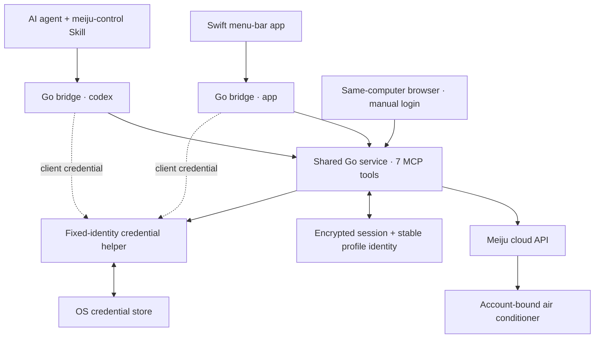

# Meiju MCP

[简体中文](README.md)

Use your own Meiju account to let an AI agent find air conditioners by home, room and device name, read their state and request controls. The Go development architecture lets a menu-bar app and agents share one account service and login.

**Version status:** [v0.2.1](https://github.com/blackcocwhite/meiju-mcp/releases/tag/v0.2.1) is the published **Python prerelease**. `main` includes unreleased Python opt-in persistence and a **Go + Swift development preview**; no new Go installation package has been released. The project is not on PyPI and is not affiliated with or endorsed by Midea/Meiju.

[Installation](docs/installation.md) · [Agent Skill](docs/agent-skill.md) · [Conversations](skills/meiju-control/references/conversations.md) · [Compatibility](docs/compatibility.md) · [Go validation](docs/go-validation.md) · [Security](SECURITY.md)

## What it does

- Opens a local browser login page for the user to enter their phone number, SMS code and, when required, image CAPTCHA on the same computer as the MCP service.
- Lists account-bound devices and reads power, setpoint, indoor temperature, mode, fan speed and candidate capabilities. Unknown fields remain unknown.
- Helps an agent resolve the target from home, room and device names, asking when the target is ambiguous.
- Provides experimental power, 17–30°C half-degree setpoints, mode and fan controls. Each write checks current device membership and state, sends once, and reads back once. Uncertain writes are not retried automatically.
- Adds shared App/agent login, opt-in encrypted persistence, restart restoration and profile relocation in the Go preview. The Swift test app defaults to read-only.

Account registration/recovery, device binding, swing, schedules, energy reporting, direct LAN control and remotely hosted login are not supported. Queries and controls require the Meiju cloud. Overseas MSmartHome accounts and other Midea appliance categories are not guaranteed to work.

## Architecture



One Go service owns one account/profile. Each client starts a lightweight stdio `bridge`, which connects to the shared loopback HTTPS service using client authentication and a pinned server certificate. App and Codex have separate local client identities. Closing a client does not log out the account; explicitly logging out affects clients sharing that profile.

Go owns cloud requests, login, device authorization, state and control. Swift owns the UI; the Skill guides the conversation. The Go/Swift runtime does not require a bundled Python environment. Its credential helper is built independently, so ordinary service/App rebuilds do not change the executable identity accessing Keychain.

**The Python entry remains available:** agent → local stdio Python MCP → Meiju cloud. Existing Python configurations are not automatically switched to Go, and neither implementation imports the other's credentials automatically. Go also has standalone stdio mode; see the [Go development guide](go-runtime/README.md).

## Choose an installation path

| Path | Intended use | Current scope |
| --- | --- | --- |
| Python v0.2.1 prerelease | Use MCP through an agent | Python 3.11+; cross-platform offline tests and macOS hardware evidence |
| Python source on `main` | Test unreleased opt-in persistence | Requires an available OS credential store for saving; `--session-only` is also available |
| Go + Swift development preview | Share one service between App and agents | Local macOS 14+ developer setup; Go 1.25+, Swift 6/Xcode command-line tools and Python 3 for installation tooling |

Windows/Linux Go binaries can be cross-compiled, but helper installers and native credential-store acceptance are incomplete. Shared-mode deployment is not offered as a ready-to-use installation on those platforms. The Swift app is macOS-only.

### Python prerelease quick start

First bind the device in the official Meiju app. Install Python 3.11+ and [uv](https://docs.astral.sh/uv/getting-started/installation/), then use a fresh directory:

```sh
git clone --branch v0.2.1 --depth 1 https://github.com/blackcocwhite/meiju-mcp.git
cd meiju-mcp
uv sync --frozen
uv run --frozen meiju-mcp --version
```

Install the [Skill](docs/agent-skill.md) before configuring the client. Set the MCP command to the environment's `meiju-mcp` executable:

```json
{
  "mcpServers": {
    "meiju": {
      "command": "/absolute/path/meiju-mcp/.venv/bin/meiju-mcp",
      "args": []
    }
  }
}
```

On Windows, use `C:\\projects\\meiju-mcp\\.venv\\Scripts\\meiju-mcp.exe`. The enclosing configuration format depends on your client. Inspect and reuse an existing `meiju` entry instead of adding duplicates. The client starts MCP; a successful version check does not prove native tools have loaded.

See [installation](docs/installation.md) for wheel/pip/Windows instructions, native Codex acceptance, and the complete Go helper/service/App sequence. Use an independent checkout and profile for the Go preview; do not overwrite a running binary or an existing login directory.

## Skill and conversation examples

MCP exposes the tools; the Skill tells the agent how to resolve devices and interpret results. Install both separately.

| Intent | Example | Behavior |
| --- | --- | --- |
| List devices | “List my Meiju devices.” | Read-only |
| Read temperature | “How warm is the bedroom?” | Separates indoor temperature from setpoint |
| Power on | “Turn on the living-room AC.” | Requests power only |
| Set temperature | “Set the bedroom AC to 26°C.” | Does not imply power-on |
| Combined control | “Turn on the living-room AC, cooling at 26°C, automatic fan.” | One combined request for an unambiguous target |
| Continue context | “Turn that one off.” | Continues only when the target is clear |

If two homes have a living room, the agent asks which one. A bedroom device is not substituted for a missing living-room device. When login is needed, the agent gives the user a newly generated local link, then resumes the original request after manual login. Do not put phone numbers, codes or tokens in chat.

These examples explain interaction, not hardware validation of every control combination. More multi-turn examples are in the [conversation guide](skills/meiju-control/references/conversations.md).

## Tools

| Tool | Purpose |
| --- | --- |
| `meiju_login` | Create or reuse the local login entry |
| `meiju_login_status` | Report authentication, restoration and persistence status |
| `meiju_logout` | Log out; shared mode also forgets the saved login |
| `meiju_list_devices` | List account-bound devices |
| `meiju_get_status` | Read the target AC's cloud-reported state |
| `meiju_get_capabilities` | Report observed fields and experimental candidate controls |
| `meiju_control` | Validate, send one control request and read back |

## Login and data protection

- Login links expire and work on the service's computer. Phone numbers and verification codes are entered in the page and are not saved in the session file.
- The published v0.2.1 uses process-memory sessions. Persistence on `main` is unreleased and requires explicitly selecting “remember this computer”.
- Saved payloads contain an encrypted access token and client device identifier. AES-256-GCM protects the file; its key is in the OS credential store. There is no plaintext/file-password fallback.
- Go uses a stable profile identity to locate keys across explicit directory migration. Migrate a stopped, consistent profile; do not run its copies as concurrent writers.
- Normal Go calls suppress credential dialogs. If authorization is needed, they return an error; an operator can explicitly authorize after understanding why, rather than triggering repeated prompts.
- These protections do not defend against malicious code running as the same user or an administrator. The development helper uses a fixed ad-hoc signature; production signing, upgrade handling and native cross-platform installation remain unfinished.

See [fixed helper](docs/fixed-vault-helper.md), [profile migration](docs/profile-migration.md), [Python persistence](docs/session-persistence.md) and [SECURITY.md](SECURITY.md).

## Validation and limits

| Area | Evidence |
| --- | --- |
| Python real login, device/state reads | Verified on macOS |
| Python power on/off | One on and one off on `KFR-35G/N8HE1ⅡPro`, with human-confirmed physical response |
| Go real login and shared App/agent reads | Verified |
| Go encrypted save, restart restoration and relocation | Verified; fresh device reads revalidated cloud authorization |
| Native Codex/Skill automatic activation and read-only calls | Verified |
| Go hardware control; independent temperature/mode/fan control | Not yet accepted on real hardware |
| Windows/Linux Go installation and credential stores | Not yet natively accepted |

Cloud readback is not proof of physical execution. Preserve `freshness: unknown`, `execution_verified: false` and experimental capability qualifiers when explaining results. Evidence from one model does not establish compatibility with all Midea ACs.

[Python validation](docs/validation.md) · [Go validation](docs/go-validation.md) · [Compatibility](docs/compatibility.md)

## Development and contributions

`src/meiju_mcp/` contains Python; `go-runtime/` contains the Go service, connectors, helpers and Swift test app; `skills/meiju-control/` contains the agent Skill.

CI checks Python offline tests, Go tests/race/vet, Windows/Linux cross-compilation, and macOS Swift builds, mock helper protocol checks and synthetic shared/migration/restart flows. CI does not log in to real accounts, access real Keychain items or control appliances. It is not hardware acceptance.

Read [CONTRIBUTING.md](CONTRIBUTING.md) before contributing. Submit only sanitized source, tests and compatibility information—not personal paths, real device identifiers, raw responses, login data, virtual environments or local backups. A source push is not a new release; existing release assets remain unchanged.

## License and attribution

[Apache License 2.0](LICENSE). Python/Go implementations follow the local Swift client's interaction contract; public application protocol constants were informed by the Apache-2.0 [sususweet/midea_auto_cloud](https://github.com/sususweet/midea_auto_cloud) project. These constants are not user credentials and grant no account/device access. See [NOTICE](NOTICE) for attribution and modifications. Third-party dependencies retain their own licenses.
