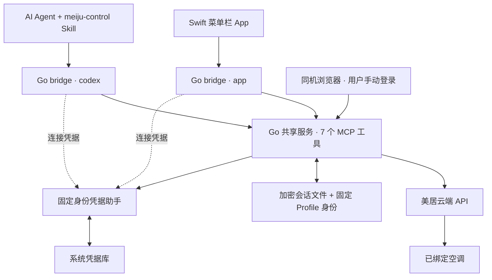

# Meiju MCP / 美居空调 MCP

[English](README.en.md)

用自己的美居账号，让 AI Agent 按家庭、房间和设备名称查询与控制空调。正在开发的 Go 共享服务让桌面菜单栏 App 和 Agent 复用同一登录态与操作逻辑。

**版本状态：**[v0.2.1](https://github.com/blackcocwhite/meiju-mcp/releases/tag/v0.2.1) 是已发布的 **Python 预发布版**。`main` 包含尚未发布的 Python 可选持久化及 **Go + Swift 开发预览**；没有发布新的 Go 安装包。项目未上架 PyPI，与美的、美居无隶属关系或官方背书。

[安装说明](docs/installation.md) · [Skill 安装](docs/agent-skill.md) · [对话示例](skills/meiju-control/references/conversations.md) · [兼容性](docs/compatibility.md) · [Go 验收](docs/go-validation.md) · [安全说明](SECURITY.md)

## 能做什么

- 用户在运行 MCP 的同一台电脑上，通过本机浏览器输入手机号、短信验证码及必要的图形验证码。
- 列举账号已绑定的设备，读取空调电源、设定温度、室温、模式、风速和候选能力；未知值保留为未知。
- Agent 按家庭、房间、设备名称匹配目标；有歧义时先澄清。
- 实验性控制电源、17–30°C 的半度步进温度、模式和风速。每次写入前核验归属并读取状态，写入一次后回读，不自动重试不确定写入。
- Go 开发版支持 App/Agent 共享登录、可选加密保存、重启恢复和保留登录态的目录迁移。当前 Swift 测试 App 默认只读。

不支持注册或找回账号、设备绑定、摆风、定时、耗电统计、局域网直连和远程托管登录。查询与控制依赖美居云端；不承诺海外 MSmartHome 账号或其他美的家电兼容。

## 架构



一个 Go 服务管理一个账号/profile。`bridge` 是客户端启动的轻量转发进程，通过带客户端认证和证书绑定的本机 HTTPS 连接共享服务；App 和 Codex 使用独立连接身份。退出客户端不等于退出账号，显式退出共享账号会影响同一 profile 的客户端。

Go 主程序负责云端协议、登录、设备权限、状态和控制；Swift 负责界面；Skill 负责对话流程。主运行程序不需要捆绑 Python 环境。固定助手独立构建，避免每次重编译服务都改变钥匙串访问身份。

**Python 入口继续保留：**Agent → 本地 stdio Python MCP → 美居云端。现有 Python 配置不会自动切换到 Go；两种实现不自动导入对方的凭据。Go 也提供独立 stdio 模式，详见 [Go 开发说明](go-runtime/README.md)。

## 选择安装路线

| 路线 | 用途 | 当前范围 |
| --- | --- | --- |
| Python v0.2.1 预发布包 | 先通过 Agent 使用 MCP | Python 3.11+；已有跨平台离线测试及 macOS 真机证据 |
| `main` 上的 Python 源码 | 验证尚未发布的可选持久化 | 系统凭据库可用时保存；也可使用 `--session-only` |
| Go + Swift 开发预览 | App 与 Agent 共享账号服务 | macOS 14+ 本机开发安装；需要 Go 1.25+、Swift 6/Xcode 命令行工具及 Python 3 安装辅助脚本 |

Go 的 Windows/Linux 程序可以交叉编译，但固定助手安装器和原生凭据库验收尚未完成，不作为可直接部署的共享模式提供。Swift App 仅支持 macOS。

### Python 预发布版快速开始

先在官方美居 App 绑定设备。安装 Python 3.11+ 和 [uv](https://docs.astral.sh/uv/getting-started/installation/)，在一个新目录执行：

```sh
git clone --branch v0.2.1 --depth 1 https://github.com/blackcocwhite/meiju-mcp.git
cd meiju-mcp
uv sync --frozen
uv run --frozen meiju-mcp --version
```

然后先安装 [Skill](docs/agent-skill.md#安装)，再把客户端 MCP 命令设为虚拟环境内的 `meiju-mcp`：

```json
{
  "mcpServers": {
    "meiju": {
      "command": "/absolute/path/meiju-mcp/.venv/bin/meiju-mcp",
      "args": []
    }
  }
}
```

Windows 使用 `C:\\projects\\meiju-mcp\\.venv\\Scripts\\meiju-mcp.exe`。配置格式以客户端为准；已有 `meiju` 条目应核对后复用，避免重复添加。MCP 由客户端启动，版本检查成功不等于原生工具已加载。

wheel、pip、Windows、Codex 首次验收，以及 Go 助手/服务/App 的完整安装顺序见[安装说明](docs/installation.md)。Go 开发版请使用独立 checkout 和 profile，不覆盖正在运行的程序或登录目录。

## Skill 与典型对话

MCP 提供工具，Skill 指导 Agent 选择目标和解释结果；两者需要分别安装。安装后可以直接说：

| 目标 | 对话示例 | 处理方式 |
| --- | --- | --- |
| 查看设备 | “查看我现在的美居设备列表” | 只读查询 |
| 查看温度 | “卧室的温度怎样” | 区分室温与设定温度 |
| 开机 | “帮我打开客厅空调” | 只请求开机，不附带其他参数 |
| 调温 | “卧室空调设为 26 度” | 不隐含开机 |
| 组合控制 | “客厅空调开机，制冷 26 度，自动风速” | 对明确目标发送一次组合请求 |
| 上下文操作 | “把刚才那台关掉” | 目标明确才继续 |

如果两个家庭都有客厅，Agent 会先澄清；只有卧室设备时，不会拿它替代客厅。未登录时，Agent 提供新生成的本机登录链接，用户在页面手动完成登录后继续原请求。不要在聊天中发送手机号、验证码或 token。

这些是对话方式示例，不代表每个参数组合都已通过真机测试。完整流程见 [Skill 对话指南](skills/meiju-control/references/conversations.md)。

## 工具

| 工具 | 用途 |
| --- | --- |
| `meiju_login` | 创建或复用本机登录入口 |
| `meiju_login_status` | 查询认证、恢复与保存状态 |
| `meiju_logout` | 退出当前账号；共享模式同时清除保存登录 |
| `meiju_list_devices` | 列出当前账号下的设备 |
| `meiju_get_status` | 读取目标空调的云端状态 |
| `meiju_get_capabilities` | 返回已观测字段和实验性候选控制能力 |
| `meiju_control` | 对明确目标执行一次受校验的控制并回读 |

## 登录与数据安全

- 本机登录链接短时有效，浏览器须和服务在同一台电脑。手机号、验证码只在页面输入，不保存到登录态文件。
- 发布的 v0.2.1 以进程内会话为主。`main` 的持久化是未发布功能，只有明确勾选“记住这台电脑”才保存。
- 保存内容为加密后的访问令牌和客户端设备标识，使用 AES-256-GCM；加密密钥位于系统凭据库，没有明文或文件密码后备。
- Go 使用固定 Profile 身份定位密钥，迁移不需要重新登录或更改助手身份；只迁移已停止且一致的 profile，不同时运行其副本。
- Go 常规调用不弹授权框。确需授权时返回错误，由操作者了解原因后显式执行授权步骤，不反复尝试。
- 本机文件与凭据库边界不抵御同用户恶意程序或管理员。开发版助手使用固定 ad-hoc 签名；正式签名、升级和跨平台原生安装仍待完成。

参见 [固定助手](docs/fixed-vault-helper.md)、[目录迁移](docs/profile-migration.md)、[Python 持久化](docs/session-persistence.md)和 [SECURITY.md](SECURITY.md)。

## 验证范围与限制

| 项目 | 已有证据 |
| --- | --- |
| Python 真人登录、设备和状态读取 | macOS 已验证 |
| Python 开机、关机 | `KFR-35G/N8HE1ⅡPro` 各验证一次，用户确认物理响应 |
| Go 真人登录、App/Agent 共享读取 | 已验证 |
| Go 加密保存、重启免登录、目录迁移 | 已验证，并重新读取设备确认云端授权 |
| 原生 Codex/Skill 自动触发与只读调用 | 已验证 |
| Go 真机控制；独立温度/模式/风速控制 | 尚未完成对应真机验收 |
| Windows/Linux Go 安装与系统凭据库 | 尚未原生验收 |

云端回读不等于物理动作证明。`freshness: unknown`、`execution_verified: false` 和实验性能力标记必须保留在结果解释中。已有一个型号的证据不代表所有美的空调兼容。

[Python 验证记录](docs/validation.md) · [Go 验证记录](docs/go-validation.md) · [兼容性说明](docs/compatibility.md)

## 开发与贡献

源码分布：`src/meiju_mcp/` 为 Python；`go-runtime/` 为 Go 服务、连接器、助手和 Swift 测试 App；`skills/meiju-control/` 为 Agent Skill。

CI 检查 Python 离线测试、Go 测试/竞态/vet、Windows/Linux 交叉编译，以及 macOS Swift 构建、助手模拟协议和合成共享/迁移/重启流程。CI 不登录真实账号、不访问真实钥匙串、不控制真机；它不能代替硬件验收。

贡献前请阅读 [CONTRIBUTING.md](CONTRIBUTING.md)。仅提交脱敏的代码、测试和兼容性信息；不要提交个人路径、真实设备标识、原始响应、登录数据、虚拟环境或本机备份。源码推送不等于发布新版本，现有 Release 附件保持不变。

## 许可与来源

[Apache License 2.0](LICENSE)。Python/Go 实现延续本地 Swift 客户端的交互契约；公共应用协议常量参考 [sususweet/midea_auto_cloud](https://github.com/sususweet/midea_auto_cloud) 的 Apache-2.0 代码。这些常量不是用户凭据，不赋予账号或设备权限。来源与修改说明见 [NOTICE](NOTICE)，第三方依赖遵循各自许可证。
