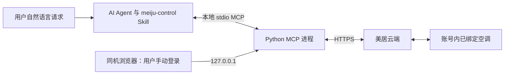

# Meiju MCP / 美居空调 MCP

[English](README.en.md)

对 AI 说“打开客厅空调”，让它通过你自己的美居账号找到设备、发送控制，并告诉你云端回读结果。

本项目提供 **Python 本地 stdio MCP 服务 + `meiju-control` Agent Skill**。当前版本 **v0.2.0，实验性**，使用 MCP Python SDK（`mcp>=2.3,<3`），需要 Python 3.11 或更新版本。设备须已绑定在官方美居 App 中。

本项目独立开发，与美的、美居无隶属关系，也未获得官方背书。源码位于 [blackcocwhite/meiju-mcp](https://github.com/blackcocwhite/meiju-mcp)，版本包见 [GitHub Releases](https://github.com/blackcocwhite/meiju-mcp/releases)。未发布到 PyPI。

[安装](#快速安装) · [AI 客户端配置](#配置-ai-客户端) · [Skill 对话示例](skills/meiju-control/references/conversations.md) · [兼容性](docs/compatibility.md) · [验证记录](docs/validation.md) · [更新记录](CHANGELOG.md) · [GitHub 上传准备](docs/github-release.md)

## 当前能做什么

- 在本机浏览器中完成手机号、短信验证码及必要的图形验证码登录。
- 列出当前账号下的设备，读取空调状态，查看候选控制能力。
- 对设备类型 `0xAC` 使用实验性 `generic_ac_lua_v1` 配置，控制电源、设定温度、模式和风速。
- 每次写入前重新核验账号设备归属并读取状态；单次写入后回读一次，不自动重试写入。

**验证范围：**2026-10-14，Python/MCP 实现在同一台 Mac、同一个 MCP 进程内完成真实账号登录、设备和状态读取，并对一台 `KFR-35G/N8HE1ⅡPro` 完成单次开机和单次关机：云端回读匹配，用户确认实机启动及关闭。初始状态和开机后状态已与美居 App 对照。温度、模式、风速的独立控制尚未测试，不能据此认定所有空调或所有 AI 客户端兼容；详见[验证记录](docs/validation.md)和[兼容性说明](docs/compatibility.md)。

| 能力 | 当前实现 | 已有真机证据 |
| --- | --- | --- |
| 登录自己的美居账号 | 本机页面输入手机号、短信及必要的图形验证码 | 已验证 |
| 列举已绑定设备 | 返回名称、家庭、房间、型号和在线信息 | 已验证一台空调 |
| 查询空调状态 | 电源、设定温度、室温、模式、风速；未知字段保持未知 | 已读取并对照 App |
| 开机、关机 | 一次局部写入，随后回读 | 同一型号各验证一次 |
| 温度、模式、风速 | 已实现受限的实验性控制字段 | 尚未进行独立真机写入测试 |
| 按自然语言选设备 | Skill 结合家庭、房间和名称；歧义时澄清 | 合成场景模拟；不等于各客户端实测 |

本版本不支持设备绑定、账号注册/找回、摆风、定时、耗电统计、局域网直连或远程托管登录，也不承诺海外 MSmartHome 账号及其他美的家电兼容。

## MCP 与 Skill 怎么配合



MCP 提供工具和参数校验，Skill 组织登录、目标匹配、读写及结果解释。账号会话保存在 MCP 进程内；Agent 不需要读取手机号、验证码或 token。**这不是离线控制方案**：设备查询和控制需要访问美居云端，设备也需要联网。

## 快速安装

先在官方美居 App 中绑定设备。安装顺序是：**准备运行环境 → 安装 MCP → [安装 Skill](docs/agent-skill.md#安装) → 配置客户端 → 在新聊天验收 → 登录美居**。先完成配置，再登录，避免为了加载 Skill 重启已经登录的进程。

### 1. 检查前置条件

需要 Python 3.11+ 和支持本地 stdio MCP 的客户端。浏览器、客户端与 MCP 须在同一台电脑；远程服务器加本地浏览器不是本版本的登录方式。

- macOS/Linux：运行 `python3 --version`；Windows PowerShell：运行 `py -3 --version`，确认所选 Python 不低于 3.11。若命令不存在或版本过旧，先从 [Python 官网](https://www.python.org/downloads/)安装合适版本。
- 使用 uv 路径时先运行 `uv --version`；没有 uv 时按 [uv 安装指南](https://docs.astral.sh/uv/getting-started/installation/)安装，或者选择下面的 pip 路径。
- 使用 Codex CLI 配置时先运行 `codex --version`，并完成客户端自身的安装和账号登录；美居登录是后面的独立步骤。桌面客户端也可通过设置界面添加 MCP。

### 2. 获取文件并安装 MCP

从 [Release](https://github.com/blackcocwhite/meiju-mcp/releases/tag/v0.2.0) 下载源码 ZIP，解压后进入含有 `pyproject.toml` 和 `uv.lock` 的目录（通常叫 `meiju-mcp-0.2.0`）。也可执行 `git clone https://github.com/blackcocwhite/meiju-mcp.git`；固定版本使用 `v0.2.0` 标签。以下 `/absolute/path/meiju-mcp` 都应替换为你的实际目录。

**源码 + uv（各平台通用）：**

```sh
cd /absolute/path/meiju-mcp
uv sync --frozen
uv run --frozen meiju-mcp --version
```

**源码 + pip，macOS/Linux：**

```sh
cd /absolute/path/meiju-mcp
python3 -m venv .venv
.venv/bin/python -m pip install .
.venv/bin/meiju-mcp --version
```

**源码 + pip，Windows PowerShell：**

```powershell
Set-Location "C:\projects\meiju-mcp"
py -3 -m venv .venv
& .\.venv\Scripts\python.exe -m pip install .
& .\.venv\Scripts\meiju-mcp.exe --version
```

**仅下载 wheel 的用户：**在一个固定的安装目录创建 `.venv`；将上面的 `pip install .` 替换为 `pip install "/path/to/meiju_mcp-0.2.0-py3-none-any.whl"`，其余版本检查和 MCP 注册步骤相同。Skill 另下载 `meiju-control-0.2.0.zip`，按[独立 ZIP 安装步骤](docs/agent-skill.md#安装)安装，不需要再下载完整源码。

版本检查应输出 `0.2.0` 后退出。**此时不要手动运行一个常驻的 `meiju-mcp` 进程**；完成 Skill 和客户端配置后，由客户端启动它。若误在终端直接运行而一直等待输入，按 Ctrl+C 停止这个手动启动的进程，再继续配置；不要停止其他已登录的会话。凭据无需写入环境变量或客户端配置。

## 配置 AI 客户端

在客户端的 MCP 配置中新增本地服务器。下面是常见的 `mcpServers` JSON 格式；配置入口和顶层结构以你的客户端说明为准。

```json
{
  "mcpServers": {
    "meiju": {
      "command": "uv",
      "args": [
        "run",
        "--frozen",
        "--directory",
        "/absolute/path/meiju-mcp",
        "meiju-mcp"
      ]
    }
  }
}
```

将目录换成源码的绝对路径。如果客户端找不到 `uv`，把 `command` 改成 `uv` 可执行文件的绝对路径。Windows 路径在 JSON 中需要转义，例如 `C:\\projects\\meiju-mcp`。

pip 安装后，也可将 `command` 指向虚拟环境内的 `meiju-mcp` 可执行文件，并使用空的 `args`：macOS/Linux 为 `/absolute/path/meiju-mcp/.venv/bin/meiju-mcp`，Windows 为 `C:\\projects\\meiju-mcp\\.venv\\Scripts\\meiju-mcp.exe`。

本版本只提供本地 stdio 传输。仅接受远程 MCP 地址的客户端、无法启动本地进程的网页 AI，不能直接接入。登录链接指向启动 MCP 进程那台机器的 `127.0.0.1`，浏览器也应在同一台机器上打开；当前不提供远程部署登录方案。

### Codex 配置与首次验收

先完成 [Skill 安装](docs/agent-skill.md#安装)，再检查 MCP 是否已有配置：

```sh
codex mcp get meiju
```

没有该条目时，根据系统添加一次。**macOS/Linux：**

```sh
codex mcp add meiju -- "/absolute/path/meiju-mcp/.venv/bin/meiju-mcp"
codex mcp get meiju
```

**Windows PowerShell：**

```powershell
codex mcp add meiju -- "C:\projects\meiju-mcp\.venv\Scripts\meiju-mcp.exe"
codex mcp get meiju
```

已有条目时先核对可执行文件路径，正确就复用，不重复添加。CLI 默认写入当前 Codex 主机的用户配置，桌面客户端和 CLI 共享该配置。桌面界面也可在 **Settings → MCP servers → Add server** 中选择 STDIO，填入上述可执行文件路径，参数留空；二选一，不要再建第二个同名服务。具体界面以[客户端官方说明](https://learn.chatgpt.com/docs/extend/mcp?surface=cli)为准。

接着完成[原生加载与对话验收](docs/agent-skill.md#原生加载与对话验收)：打开新的本机聊天或交互式 Codex CLI，在 `/mcp` 中确认 `meiju` 已连接，再直接说“查看我现在的美居设备列表”。首次未登录时出现本机登录链接是正常结果。

`codex mcp get` 只能证明配置已保存，不能证明工具已加载。首次配置尚未登录时，若宿主要求 Restart/重新加载，可按设置提示完成；已有登录会话不要为了测试而重启。工具仍缺失时先查启动错误、可执行路径和依赖，不要让 Agent 另开一个终端 MCP 进程冒充原生连接。

## 自然语言控制 Skill

配套标准 Skill [`meiju-control`](skills/meiju-control/SKILL.md) 支持“打开客厅空调”“把卧室设为26度”“把刚才那台关掉”。Agent 会读取账号设备列表，结合家庭、房间和名称定位；唯一明确匹配则执行，重名、位置冲突或零匹配时才澄清。

MCP 与 Skill 需要分别接入和安装。Skill 的安装方法、只读验收和跨客户端边界见[使用说明](docs/agent-skill.md)。只安装 Python 包不会自动把 Skill 安装到 Agent，也不代表宿主已经加载它。

安装后可直接这样对话：

| 想做什么 | 可以怎么说 | 操作范围 |
| --- | --- | --- |
| 看设备 | “查看我现在的设备列表” | 只读，不控制 |
| 看室温 | “卧室的温度怎样” | 区分室温和设定温度 |
| 开机 | “帮我打开客厅空调” | 只开机，不附带温度或模式 |
| 关机 | “把刚才那台关上” | 上下文目标明确时关机 |
| 调温 | “卧室空调设为26度” | 只调温，不隐含开机 |
| 组合设置 | “客厅空调开机，制冷26度，自动风速” | 合并为一次控制 |
| 切换家庭 | “打开办公室的会议室空调” | 用已确认的家庭与房间范围定位 |

如果“客厅”同时匹配两个家庭，Agent 会先让你选定；如果只有卧室空调，不会拿它替代客厅。完整的首次登录、重名设备、结果不确定等多轮示例见 [Skill 对话指南](skills/meiju-control/references/conversations.md)。其中温度、模式、风速示例说明使用方式，不代表已通过相应真机测试。

## 登录与使用

连接后可对 AI 说：

> 打开美居登录入口。等我在浏览器完成登录后，再列出我的空调。

1. AI 调用 `meiju_login`，取得随机端口的本机浏览器链接。
2. 你打开链接，在页面上手动输入手机号、短信验证码和必要的图形验证码。**不要在聊天中发送这些信息。**
3. 完成后，让 AI 调用 `meiju_login_status` 确认登录，再调用 `meiju_list_devices`。
4. 选择列表中的设备，先查询 `meiju_get_status` 和 `meiju_get_capabilities`，再请求具体控制。

例如：

> 查看客厅空调当前温度、模式和候选控制能力。
>
> 把刚才选中的客厅空调设为制冷、26°C；完成后告诉我回读结果。
>
> 退出这次美居登录。

这些文字是使用示例，并非已经执行的设备操作。如果存在重名设备，让 AI 根据设备列表确认目标。控制结果应以回读的实际状态说明；超时或回读不一致时，不应宣称控制成功，也不要自动重复写入。

| 工具 | 用途 |
| --- | --- |
| `meiju_login` | 创建或复用本机登录入口；凭据由你在浏览器输入 |
| `meiju_login_status` | 查询本 MCP 进程的登录状态 |
| `meiju_logout` | 清除本进程的内存会话 |
| `meiju_list_devices` | 列出当前账号可访问的设备 |
| `meiju_get_status` | 读取指定设备的云端状态 |
| `meiju_get_capabilities` | 返回候选配置和实际观察到的字段 |
| `meiju_control` | 发送受约束的空调控制并回读一次 |

`meiju_login()` 在需要登录时返回 `status: "login_required"` 与 `login_url`，不会自动打开浏览器。已登录时返回 `authenticated`；同一进程内重复调用会复用仍有效的登录入口。

控制工具参数为 `device_id`，以及可选的 `power`、`target_temperature`、`mode`、`fan_speed`。设备 ID 应原样使用列表中返回的值，不自行构造。下面仅用合成 ID 展示参数格式：

```json
{
  "device_id": "synthetic-device-001",
  "target_temperature": 26,
  "mode": "cool"
}
```

一次调用可同时设置多个字段，合并为一次局部写入。客户端只发送明确指定的字段；调整温度或模式不会隐式附加开机指令，需要开机时明确传入 `power: true`。设备或云端回读中的其他字段仍可能变化：本次只发送开机时，回读温度与风速也发生变化，具体原因未确认。应以回读和用户观察说明结果。

AI 工具接口不直接接收手机号、验证码或 token。会话仅保存在 MCP 进程内存中，同一进程可复用；重启进程或退出登录后需要重新登录。已有 Mac App 的登录态不会自动迁移，各客户端启动的独立 MCP 进程也不会共享会话。

## 控制边界

当前候选配置接受电源开关、17–30°C 且步长为 0.5°C 的设定温度、`cool` / `heat` / `auto` / `dry` / `fan` 模式，以及 `silent` / `low` / `medium` / `high` / `full` / `auto` 风速。**这是客户端策略，不是已确认的硬件能力。**某台设备可能不支持制热、半度调节或某档风速。

`meiju_get_capabilities` 展示候选 profile 与观察到的状态字段，不会自动发现硬件的完整能力。缺失或未知字段保持未知，不填入默认状态。当前不接受任意原始指令，不支持的设备类型会被拒绝，也不提供摆风、定时等未实现的控制。

控制使用 `commoncloud` 的 `/mjl/v1/device/lua/control` 接口。账号下的设备列表与写入前检查用于限制目标，最终访问权限仍由美居服务端校验。你必须使用自己的账号及授权设备。本项目不负责设备绑定、账号注册或找回。

云端接口、风控、短信限制及设备固件可能变化。发生错误时先读取状态；状态不明确时保留“不确定”的结论，不将云端请求被接受等同于设备已执行。

## 开发与测试

```sh
uv sync --frozen --group dev
uv run --frozen ruff check .
uv run --frozen pytest
uv build
```

自动化测试使用合成数据与 mock 传输，不需要账号、短信、访问 token 或真实设备。CI 配置覆盖 Linux Python 3.11/3.13，并在 macOS/Windows 上安装和运行测试；配置的存在不等于这些平台已经通过远程 CI 或实机验证。

不同阶段的离线测试、真机验证与版本构建结果分开保存在[验证记录](docs/validation.md)，避免把模拟测试通过误认为所有设备已经兼容。

## 常见问题

**只装 MCP 就能用吗？** 支持 MCP 的 Agent 可以直接调用工具；配套 Skill 提供一致的选设备和对话流程，需要另外安装。

**每次都要登录吗？** 同一个 MCP 进程可复用会话。重启进程、退出登录或云端会话过期后需要重新登录；不同 Agent 启动的独立进程互不共享。

**为什么终端运行后没有界面？** 这是等待客户端输入的 stdio MCP 服务。登录页面由 `meiju_login` 按需创建。

**为什么显示在线，但空调没有开？** 在线是设备联网状态，开机由独立的电源字段表示。

**云端说开机就一定启动了吗？** 不一定。回读可能有缓存；真机验收还需要观察设备或对照 App。不确定时先读状态，不自动再发一次控制。

**版本包里有什么？** 源码 ZIP 与 sdist 包含源码、文档、测试和 Skill；wheel 只安装 Python 服务；Skill ZIP 可单独交给支持 Skill 的 Agent。版本升级与公开仓库准备见 [GitHub 上传说明](docs/github-release.md)。

提交兼容性报告时，请按[贡献指南](CONTRIBUTING.md)和[兼容性模板](.github/ISSUE_TEMPLATE/compatibility.yml)提供脱敏信息。安全问题请参阅 [SECURITY.md](SECURITY.md)。不要提交个人设备 ID、SN、截图、真实云端响应、APK 或反编译全文。

## 许可与来源

本项目采用 [Apache License 2.0](LICENSE)。原生 Python 实现移植了本地 Swift 客户端的交互契约；公共应用协议常量参考 [sususweet/midea_auto_cloud](https://github.com/sususweet/midea_auto_cloud) 的 Apache-2.0 代码。这些协议常量不是用户访问 token，也不赋予任何账号或设备权限。

完整许可文本及来源、修改说明见 [LICENSE](LICENSE) 和 [NOTICE](NOTICE)。各第三方依赖仍遵循其各自许可证。美的、美居等名称和商标归其各自权利人所有。
